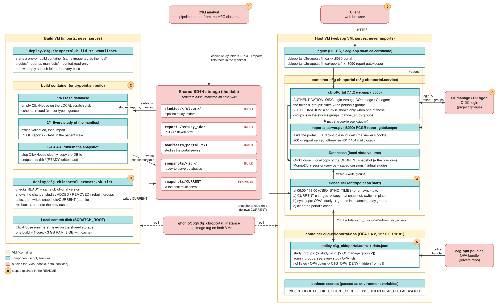

# c3g_cbioportal_instance
_Last Modified:_ 2026-11-24

**Authors:** Gerardo Zapata

Private [cBioPortal](https://www.cbioportal.org/) 7.1.2 for C3G client studies (GRCh38): one podman image holding the webapp, ClickHouse, MongoDB and session-service.
Login through C3G COmanage (OIDC/CILogon). The app's own **OPA** decides which COmanage group sees which study; a person's groups come from their login token ([Who can see what](#who-can-see-what)).
Each sample's **PCGR report** opens as a tab in the patient view, with the same access.
Home page: the full C3G logo with a welcome and contact text (`CBIO_SKIN_BLURB`). Header: the C3G emblem, left of the login button (`CBIO_RIGHT_LOGO`).

- URL: https://cbioportal.c3g-app.sd4h.ca
- Image: `ghcr.io/c3g/c3g_cbioportal_instance` (private: `podman login ghcr.io` first)

<br/>

---

<br/>

> ⚠️ **AI-written.** This README and the code in this repo (`entrypoint.sh`, `reports_server.py`, `Containerfile`, `run.sh`, `deploy/`, the OPA policy) were written with an AI assistant (Claude, Anthropic). Check it against the code and test it before relying on it, especially access control. The Builder / Hosting split has not been run on the VMs yet, and OPA mode has not been run end to end yet.

<br/>

---

<br/>

## How it works



<sub>Diagram source: [`overview.svg`](overview.svg).</sub>

One image, two jobs, on two SD4H VMs. The data lives on a separate node, the **shared SD4H storage**, mounted on both VMs. The **Build VM** turns it into a ready-to-serve database (a **snapshot**). The **Host VM** serves that snapshot and controls who sees what.

1. **Data in.** The C3G analyst copies the pipeline output to the shared storage:
   - study folders go to `studies/`;
   - PCGR reports go to `reports/<cancer_study_identifier>/`;
   - every study the portal should serve is listed in `manifests/portal.txt`, which is the full list.
2. **Build (Build VM).** `deploy/c3g-cbioportal-build.sh <manifest>` starts a one-off container from the same image. The container:
   - creates an empty ClickHouse database on the Build VM's **local** scratch disk (never on the shared storage) and loads the schema and seed;
   - validates and imports every study in the manifest, adding the PCGR report tabs;
   - publishes the database as `snapshots/<YYYYmmdd-HHMMSS>/`, writing `READY` last.
3. **Promote (Build VM).** `deploy/c3g-cbioportal-promote.sh <id>`:
   - checks the snapshot (`READY` present, same cBioPortal version);
   - shows what changes against `CURRENT`: studies added, removed or rebuilt, and changed groups;
   - asks, then writes `snapshots/CURRENT`.
4. **Host sync (Host VM).** The host mounts `snapshots/` read-only. At **06:00 and 18:00** (`CBIO_SYNC_TIMES`), or right away with `sync-now`, it copies the snapshot named in `CURRENT` to its local `/data` volume and switches to it in place, **without a restart**.
5. **Authorization (OPA).** At the same sync, the host asks its own OPA container which COmanage groups may see each study. The answer comes from `c3g_cbioportal/data.json` in the c3g-opa-policies bundle, and the host writes it into its copy (`cancer_study.groups`). A study that OPA doesn't list is hidden from everyone. If OPA is down, every study is hidden.
6. **Client.** The browser reaches the portal over HTTPS through the VM's nginx (`cbioportal.c3g-app.sd4h.ca`). Requests under `/reports/` go to the PCGR report gatekeeper.
7. **Authentication (COmanage / CILogon).** cBioPortal's own OIDC login sends the person to COmanage / CILogon. Their token carries their COmanage groups (the `groups` claim).
   - A person sees a study only when one of their groups is one of that study's groups.
   - A PCGR report is served only when the portal says that person may see its study.

More detail: [Who can see what](#who-can-see-what) and [The ClickHouse database](#the-clickhouse-database).

- **During a switch:** the new snapshot is copied while the old one still serves. Then only ClickHouse restarts (~10–20 s of page errors); logins, the webapp and saved sessions stay up. If the new database doesn't come up, the old one is put back.
- **Roll back:** promote the previous snapshot id.
- **A snapshot that doesn't come up** (at a switch or at start) is put aside as `/data/clickhouse.failed`. The previous copy keeps serving, and that id is not tried again. Build a new snapshot and promote it.
- Both VMs must run the **same image tag**. The host and `promote` refuse a snapshot built with another cBioPortal version.

<br/>

---

<br/>

## Step by step

`S=/Path/to/YOUR/cBioPortal` = the shared storage (layout in [How it works](#how-it-works)). Commands run from the repo root.

### For updating: add, update or remove a study (Build VM)

**1. Study folder.** Copy the pipeline's cBioPortal study folder as it is (no symlinks: only `studies/`, `reports/`, `manifests/` are mounted).

```bash
S=/Path/to/YOUR/cBioPortal
cp -r <pipeline_output>/<study_folder> ${S}/studies/
grep -E '^(cancer_study_identifier|groups):' ${S}/studies/<study_folder>/meta_study.txt
#   cancer_study_identifier: <study_id>
#   groups: <PROJECT>;C3G_ADMINS          ignored on the host: OPA decides (step 8)
```

**2. PCGR reports (optional).** One flat folder per study, named after its `cancer_study_identifier`.

```bash
SID=$(sed -n 's/^cancer_study_identifier:[[:space:]]*//p' ${S}/studies/<study_folder>/meta_study.txt | tr -d '[:space:]')
mkdir -p ${S}/reports/${SID}
find <pipeline_output> -name '*.pcgr_acmg.grch38.flexdb.html' -exec cp {} ${S}/reports/${SID}/ \;
```

**3. Manifest.** The **full** list of study folders the portal serves, one per line.

```bash
echo <study_folder> >> ${S}/manifests/portal.txt
cat ${S}/manifests/portal.txt
```

- Update a study: replace its folder. Remove one: delete its line.

**4. Check before building** (a typo fails here, not after a long build).

```bash
for f in $(grep -vE '^[[:space:]]*(#|$)' ${S}/manifests/portal.txt); do
  m=${S}/studies/${f}/meta_study.txt
  [ -s "${m}" ] || { echo "MISSING ${m}"; continue; }
  id=$(sed -n 's/^cancer_study_identifier:[[:space:]]*//p' "${m}" | tr -d '[:space:]')
  echo "${f}: id=${id} groups=$(sed -n 's/^groups:[[:space:]]*//p' "${m}") reports=$(ls ${S}/reports/${id}/*.html 2>/dev/null | wc -l)"
done
```

**5. Build** a new snapshot (full rebuild; ClickHouse on local scratch).

```bash
SHARED=${S} SCRATCH_ROOT=/Path/to/YOUR/BuilderScratch ./deploy/c3g-cbioportal-build.sh portal.txt
# -> Snapshot ready: .../snapshots/<id>
```

**6. Promote** it: shows `ADDED` / `REMOVED` / `groups` changes against `CURRENT`, asks, writes `CURRENT`.

```bash
SHARED=${S} ./deploy/c3g-cbioportal-promote.sh <id>
```

**7. Live.** The host switches at **06:00 or 18:00**, without a restart. To switch now, on the host: `sync-now` (For hosting, step 5). Roll back: promote the previous id.

**8. Access.** A new study is **hidden from everyone** until it is in OPA's policy: add `"<study_id>": ["<COmanage group>"]` to `c3g_cbioportal/data.json` in c3g-opa-policies, and put the people in that COmanage group ([Who can see what](#who-can-see-what)). Applied at 06:00 / 18:00 or with `sync-access`.

### For hosting: run the portal (webapp VM)

**1. Volume.** Local disk, mounted as `/data`.

```bash
VOL=/Path/to/YOUR/HostData
mkdir -p ${VOL}
```

**2. Secrets and image login.**

```bash
printf '%s' '<oidc_client_secret>' | podman secret create C3G_CBIOPORTAL_OIDC_CLIENT_SECRET -
python3 -c 'import secrets; print(secrets.token_hex(16), end="")' | podman secret create C3G_CBIOPORTAL_CH_PASSWORD -
podman login ghcr.io                  # classic token with read:packages, authorized for the c3g org
```

**3. Units.** OPA first, then the portal. Fill the `<...>` placeholders: bundle URL (OPA unit), issuer URL, client ID, snapshots path, host ports. Keep `CBIO_DB_SNAPSHOT=current` and `CBIO_AUTHZ=opa`.

```bash
cp deploy/c3g-cbioportal-opa.service deploy/c3g-cbioportal.service ~/.config/systemd/user/
nano ~/.config/systemd/user/c3g-cbioportal-opa.service      # <bundle_url> (ASK: not ready yet)
nano ~/.config/systemd/user/c3g-cbioportal.service
```

- `snapshots/CURRENT` must exist before the first start: do For updating steps 1–6 once.

**4. Start.**

```bash
systemctl --user daemon-reload && systemctl --user enable --now c3g-cbioportal-opa.service c3g-cbioportal.service
podman logs -f c3g-cbioportal                                # ready at "All services up, serving snapshot <id>"
podman exec c3g-cbioportal /app/entrypoint.sh snapshots      # CURRENT, served, next sync
```

**5. Day to day** (no restarts needed).

```bash
podman exec c3g-cbioportal /app/entrypoint.sh sync-now       # take a promoted snapshot now (else 06:00 / 18:00)
podman exec c3g-cbioportal /app/entrypoint.sh sync-access    # apply an OPA policy change now (always after removing a group)
podman exec c3g-cbioportal /app/entrypoint.sh studies        # studies + their groups (C3G_OPA_DENY = hidden)
```

**6. Stop cleanly** (ordered shutdown, ClickHouse last).

```bash
systemctl --user stop c3g-cbioportal.service
```

<br/>

---

<br/>

## Who can see what

Login is **OIDC through C3G COmanage / CILogon**. COmanage proves who the person is, and its token carries their **groups** (claim `groups`). The app's own **OPA** says which groups may see which study. A person sees a study when one of their token groups is one of that study's groups.

```
STUDY side   c3g-opa-policies  c3g_cbioportal/data.json  (OPA bundle, private repo)
             {"admin_groups": ["<C3G admins group>"],
              "study_groups": {"<study_id>": ["<project group>", ...]}}

PEOPLE side  COmanage: membership of the project's group  -> 'groups' claim in the login token

At sync:     OPA's study -> groups table is written into the host's DB copy (cancer_study.groups)
At login:    the token's groups are compared with each study's groups (ignoring case)
```

| To... | Do | Rebuild? |
|-------|----|----------|
| Let a person see a project | Add them to the project's COmanage group | No. Effective at their next login |
| Remove a person | Remove them from the COmanage group | No. Their open session keeps its groups until it expires |
| Let a group see a study / stop it | Edit the study's line in `c3g_cbioportal/data.json` (c3g-opa-policies) | No. Applied at 06:00 / 18:00, or now with `sync-access` |
| Give C3G staff access to everything | Put their COmanage group in `admin_groups` | No. Admins see every study OPA **lists** |

- **Fail closed.** A study OPA doesn't list gets the group `C3G_OPA_DENY`, so nobody sees it. If OPA doesn't answer (3 tries, 10 s apart), **every** study gets it until OPA is back. Never create a COmanage group called `C3G_OPA_DENY`.
- **When it is applied:** at host start (before the webapp), after every snapshot switch (each snapshot starts with the pipeline's groups), at each sync time (06:00 and 18:00), and on `sync-access`. Then cBioPortal's cache is cleared.
- **Group strings** must match the token exactly as COmanage sends them (full COmanage name or short name: check one real token). They may not contain `;`, quotes or backslashes.
- **`meta_study.txt` `groups:`** is still accepted by the build but replaced on the host. The build doesn't need it.
- **The build** asks OPA only when `OPA_URL` is passed to it, and then only warns about studies OPA doesn't list.
- **The policy:** a copy for development is in [`opa/c3g_cbioportal/`](opa/c3g_cbioportal/); the real one lives in c3g-opa-policies. Test it with `opa test opa/ -v` (from the repo root, never the policy folder itself, because OPA names the data after its folder).
- **How it works inside:** cBioPortal reads the user's groups from the token (`spring.security.oauth2.client.jwt-roles-path=groups`). `entrypoint.sh sync_opa` asks OPA `POST /v1/data/c3g_cbioportal/authz/study_access` and writes the answer into `cancer_study.groups` with `ALTER TABLE ... UPDATE`.
- **Users-file mode (off, kept).** cBioPortal's own authorization (`CBIO_AUTHZ=cbioportal`: `/data/access/users.tsv` + `meta_study.txt` groups, `authorization=true`) is still in the code but not used.

<br/>

---

<br/>

## Commands

### Build a snapshot (Build VM)

```bash
SHARED=/Path/to/YOUR/cBioPortal \
SCRATCH_ROOT=/Path/to/YOUR/cBioPortal/BuilderScratch \
IMAGE=ghcr.io/c3g/c3g_cbioportal_instance:latest \
  ./deploy/c3g-cbioportal-build.sh portal.txt
```

- Each run starts from an empty database: schema + seed (~10–15 min), then every study in `manifests/portal.txt`. The manifest is the **full** list of studies, not just the new ones.
- ClickHouse runs on the local `SCRATCH_ROOT` disk, never on the shared storage. Needs ~18 GB RAM.
- PCGR reports in `reports/<cancer_study_identifier>/` are linked to their samples (`<SAMPLE_ID or PATIENT_ID>.pcgr_acmg.grch38.flexdb.html`) and copied into the snapshot. The study folder is never changed.
- Success: `snapshots/<id>/` with `READY` written last. Failure: only `<id>.partial/` is left, and the host refuses it.
- Access isn't decided at build time: OPA decides on the host. With `OPA_URL=http://<opa_host>:8181` the build warns about studies OPA doesn't list (those would be hidden).
- Snapshots and scratch folders are never deleted automatically.
- A new snapshot is **not** live until it is promoted (next section). `PROMOTE=true ./deploy/c3g-cbioportal-build.sh portal.txt` runs the promote right after a good build.

### Put a snapshot live: promote (Build VM)

```bash
SHARED=/Path/to/YOUR/cBioPortal ./deploy/c3g-cbioportal-promote.sh 20261120-143000
```

- Checks the snapshot (READY, same cBioPortal version), then shows each study against the current `CURRENT`: `ADDED`, `REMOVED`, `groups` changed (old → new), `rebuilt`, `same`, with the number of PCGR reports. The groups shown are the pipeline's `meta_study.txt` ones; on the host OPA replaces them.
- Asks `y/N`. If a study would **disappear** (a line left out of the manifest?), you have to type `yes`.
- Writes `snapshots/CURRENT` in one step and adds a line to `snapshots/promote.log` (date, old → new id, who).
- `--yes` skips the question (scripts); it refuses when a study would be removed unless `CBIO_ALLOW_REMOVE=true`.
- **Roll back:** promote the previous id the same way.
- It runs on the Build VM because only that VM can write to `snapshots/`.

### Start the portal (Host VM)

```bash
cp deploy/c3g-cbioportal-opa.service deploy/c3g-cbioportal.service ~/.config/systemd/user/.
systemctl --user enable --now c3g-cbioportal-opa.service c3g-cbioportal.service
podman logs -f c3g-cbioportal                               # ready at "All services up, serving snapshot <id>"
```

- Before the first start, fill the `<...>` placeholders in the units: bundle URL, issuer URL, client ID, ports, snapshots path. Promote a first snapshot on the Build VM (so `snapshots/CURRENT` exists). Start OPA first ([Who can see what](#who-can-see-what)).
- Startup order: copy the snapshot (if new) → ClickHouse → OPA's groups → MongoDB → session-service → webapp → report server. Then it waits for the next sync time.
- It refuses to start without the OIDC settings. If `CURRENT` is missing or not usable (no `READY`, other cBioPortal version), it keeps serving its local copy and warns; it only refuses when it has no local copy yet.
- `CBIO_DB_SNAPSHOT=<id>` instead of `current` **pins** the host to that snapshot: it never follows `CURRENT` (for debugging).
- OPA not answering → the portal starts, but **every study is hidden** (fail closed) until the next sync that reaches OPA (or `sync-access`).
- The same command without systemd is in [`run.sh`](run.sh).

### Switch to the promoted snapshot now (Host VM)

```bash
podman exec c3g-cbioportal /app/entrypoint.sh sync-now
```

- Runs the scheduled sync right away instead of waiting for 06:00 / 18:00: switch to `CURRENT` if it changed, re-apply OPA's groups, clear cBioPortal's cache. Prints the result.
- No restart: the previous local copy is kept as `/data/clickhouse.prev/`. MongoDB (users' saved sessions and virtual studies) is not touched.
- Every sync is logged in `/data/logs/sync.log`, every switch in `/data/logs/snapshot_switch.log`.
- Times: `CBIO_SYNC_TIMES` (default `06:00 18:00`) in the container's time zone (`TZ=America/Toronto` in the unit).

### List snapshots

```bash
podman exec c3g-cbioportal /app/entrypoint.sh snapshots
```

Shows `CURRENT`, the snapshot served here, the last and next sync, then each snapshot's id, READY, cBioPortal version, size and studies. `*` marks the one being served, `>` the one in `CURRENT`.

### List studies and who can see them

```bash
podman exec c3g-cbioportal /app/entrypoint.sh studies
```

`groups` = the groups that can see the study, as last written from OPA. `C3G_OPA_DENY` = hidden (OPA doesn't list it, or OPA was down).

### Apply an OPA policy change now

```bash
curl -s -X POST http://127.0.0.1:8181/v1/data/c3g_cbioportal/authz/study_access   # what OPA allows now (on the VM)
podman exec c3g-cbioportal /app/entrypoint.sh sync-access
```

This asks OPA, prints each study whose groups change (`old -> new`), writes them, and clears cBioPortal's cache. The same sync runs on its own at 06:00 and 18:00, so **run `sync-access` after taking a group off a study**. Whether OPA has the new policy yet depends on its bundle polling.

### Health check, stop, start

```bash
podman healthcheck run c3g-cbioportal                    # every service answers
systemctl --user stop c3g-cbioportal.service             # ordered shutdown, ClickHouse last (up to 5 min)
systemctl --user start c3g-cbioportal.service
```

### Local test (laptop, no login, never on the VMs)

```bash
podman build -t c3g_cbioportal_instance:dev -f Containerfile .
mkdir -p shared/{studies,reports,manifests,snapshots} scratch host     # study + reports + manifests/test.txt
SHARED=./shared SCRATCH_ROOT=./scratch IMAGE=c3g_cbioportal_instance:dev MEMORY=12g \
  CBIO_REPORTS_URL=http://localhost:8090/reports ./deploy/c3g-cbioportal-build.sh test.txt
podman run -d --name cbio-test --stop-timeout=300 -e CBIO_AUTH=false -e CBIO_DB_SNAPSHOT=<id> \
  -e CBIO_REPORTS_URL=http://localhost:8090/reports -e CBIO_PORTAL_ORIGIN=http://localhost:8080 \
  -v ./host:/data:Z -v ./shared/snapshots:/snapshots:ro \
  -p 127.0.0.1:8080:8080 -p 127.0.0.1:8090:8090 c3g_cbioportal_instance:dev
```

Every other setting (`-e VAR=...`) is listed with its default at the top of [`entrypoint.sh`](entrypoint.sh) (`## CHANGE HERE ##`).

<br/>

---

<br/>

## For web app maintainers

From the C3G [web-app-template](https://github.com/c3g/web-app-template/blob/main/for-maintainers.md), what this app needs. Items marked **ASK** are still open.

| Item | This app |
|------|----------|
| Login | `bastion_ssh <you>@prod-appserver-podman-1` → `sudo machinectl shell genome@` (not `sudo -s`) |
| Units | [`deploy/c3g-cbioportal.service`](deploy/c3g-cbioportal.service), and [`deploy/c3g-cbioportal-opa.service`](deploy/c3g-cbioportal-opa.service) (start it first), installed to `~/.config/systemd/user/` |
| Updates | `--label io.containers.autoupdate=registry`: a published GitHub Release (`latest`) is picked up within ~15 min. Roll back by pinning a release tag (`:v1.0.0`). A release that changes cBioPortal's version also needs a new snapshot, so pin the old tag until the new snapshot is ready. A unit from before the promote / fixed-time sync (pinned `CBIO_DB_SNAPSHOT=<id>`, `CBIO_SYNC_SECS`) keeps working with a newer image: it stays pinned and warns |
| Volume | "Reserve space" in the template, `APPNAME=cbioportal` (XFS label ≤ 12 characters) → `/home/genome/cbioportal-volume:/data:Z`. Must be local/block disk (ClickHouse runs on it) |
| Shared storage | `snapshots/` mounted read-only on the webapp VM; the whole folder read-write on the Build VM. Storage type, mount point, same `genome` uid/gid on both VMs: **ASK** SD4H admins. Mounted without `:Z` (never relabel shared storage) |
| Secrets | Prefixed podman secrets, passed as env vars:<br/>`printf '%s' '<value>' \| podman secret create C3G_CBIOPORTAL_OIDC_CLIENT_SECRET -`<br/>`python3 -c 'import secrets; print(secrets.token_hex(16), end="")' \| podman secret create C3G_CBIOPORTAL_CH_PASSWORD -`<br/>To change one: `podman secret rm`, create again, restart the unit |
| Database | None on the shared Postgres: ClickHouse + MongoDB run inside the container |
| OIDC client | From the COmanage admins. Redirect URI `https://cbioportal.c3g-app.sd4h.ca/login/oauth2/code/cbio-idp`, `authorization_code` / `client_secret_basic`, scopes `openid profile email org.cilogon.userinfo`, claims `email name` **and `groups`** (the COmanage project groups; study access depends on them) |
| Auth tier | 3b shape: cBioPortal's own OIDC login + the app's own OPA. No oauth2-proxy: nginx goes straight to the app |
| OPA | Own container `c3g-cbioportal-opa`, pinned `openpolicyagent/opa`, `-p 127.0.0.1:8181:8181` (**ASK** port), policy `c3g_cbioportal/` in c3g-opa-policies, `--bundle <bundle_url>` (**ASK**: not ready yet). The portal reaches it at `http://10.0.2.2:8181` (`CBIO_AUTHZ=opa`, `OPA_URL`) |
| Ports | `8080` portal, `8090` PCGR report server: **ASK** which host ports |
| nginx | Template server block (`*.c3g-app.sd4h.ca` certificate), `server_name cbioportal.c3g-app.sd4h.ca;`, `proxy_pass http://172.16.8.75:<portal_port>;` plus the block below (same host name, so the login cookie reaches the report server) |
| Stop timeout | `--stop-timeout=300` / `TimeoutStopSec=330`: ClickHouse needs time to stop cleanly |
| RAM | Webapp VM ≥ 16 GB; Build VM ≥ 20 GB |

```nginx
location /reports/ {
    proxy_pass http://172.16.8.75:<reports_port>;   # 8090
    proxy_set_header Host $host;
    proxy_set_header X-Forwarded-For $proxy_add_x_forwarded_for;
}
```

Departures from the template that need maintainer sign-off:
- ClickHouse and MongoDB run inside the container instead of the shared Postgres.
- Login is cBioPortal's own OIDC, and OPA's decision is written into cBioPortal's database (twice a day) instead of being asked per request; there is no oauth2-proxy or Flask OPA library.
- A second VM (the Build VM) does the imports.
- The stop timeout is 300 s.

### The ClickHouse database

**What it is:** cBioPortal 7 keeps all study data in one ClickHouse database, `cbioportal` (63 tables).
- The webapp only reads it.
- Most of it is **seed** data loaded with every build: genes, gene sets, cancer types.
- Each study adds its own rows: samples, mutations, copy number, structural variants, case lists, PCGR report links.
- `*_derived` tables are precomputed for the study view and rebuilt after each import.

**On disk:** a ClickHouse database is a plain folder, the same in the snapshot and on the host:

```
clickhouse/
├── metadata/cbioportal/*.sql      table definitions ("ATTACH TABLE mutation ...")
├── store/<abc>/<uuid>/            one folder per table
│   └── all_1_1_0/                 one "part" per insert: one compressed .bin file per column
└── status, uuid, tmp/, ...        server bookkeeping
```

- Size: ~51 MB for the seed plus one WES study of 86 samples (Narval test). It grows with each study.
- The internal links are absolute (`/data/clickhouse/store/...`), so the folder only works at `/data/clickhouse` (`CBIO_DATA_DIR` must be the same on both VMs).
- Only one ClickHouse server may use a folder at a time. That's why the host serves a **copy** of the snapshot, and why ClickHouse never runs on the shared storage.

**Who writes it:**

| Who | Writes |
|-----|--------|
| Builder | Everything: schema, seed, every study in the manifest, derived tables |
| Host | Its local copy only: schema migration at start and after a switch, and `cancer_study.groups` from OPA (at each sync) |
| Webapp | Nothing (users' saved sessions go to MongoDB, not ClickHouse) |

**Adding more studies:** the database is **rebuilt from scratch on every build**. Studies are never added to the running database.

```
manifests/portal.txt                    build                          host
  study_A          ─┐
  study_B           ├──►  empty DB + seed + A + B + C  ──►  snapshots/<new id>/  ──►  promote (CURRENT) ──► switch at 06:00 / 18:00
  study_C  (new)   ─┘
```

1. Copy the new study folder to `studies/`, its PCGR reports to `reports/<cancer_study_identifier>/`. Add the study to `c3g_cbioportal/data.json` in c3g-opa-policies.
2. Add one line to `manifests/portal.txt`. Keep the existing lines.
3. Build → a new snapshot holding all the studies, old and new.
4. Promote it (`deploy/c3g-cbioportal-promote.sh <new id>`). The host switches at 06:00 or 18:00 (or `sync-now`), without a restart. The previous snapshot stays as the rollback.

- **Replace a study:** update its folder, then build. **Remove a study:** delete its line, then build.
- **Why a full rebuild:** each snapshot is exactly its manifest, so it can be rebuilt and nothing drifts. cBioPortal can't add PCGR report links to an existing study anyway.
- **Cost:** every build reloads the seed (~10–15 min), plus each study's import (usually minutes). Long imports usually mean a problem in the pipeline output. On Narval, duplicate gene/sample rows in `data_cna_long.txt` took 68 of 70 minutes.
- **Access:** never in a snapshot. The host writes OPA's groups into its copy after each switch, so changing access never needs a rebuild.
- **Why promote is a separate step:** a build that *runs* fine isn't always *right* (a study left out of the manifest). Promote shows the difference and asks before anything goes live.
- Each snapshot is a full copy, so delete old ones by hand once they're no longer needed for a rollback.

<br/>

---

<br/>

## Open questions

- **What about the POST verification? Where should it go?** The idea is an authenticated POST: an app key in a request header, checked as in `require_appkey` in run_processing_dashboard's `API.py`. It would check the shared storage against what the portal displays. Not implemented yet. Still open:
  - who sends the POST;
  - what it checks;
  - whether it also triggers the sync;
  - where the endpoint runs.
- **Where will the builder live, and the host?**
- **Do we need a separate VM?** A build so far needs about 1 core and ~3 GB of real memory (see [Resources](#resources-measured-on-sd4h-cardinal)).

<br/>

---

<br/>

## Resources (measured on SD4H Cardinal)

**Test setup.** The `sd4h_test` branch ran on Cardinal on 2026-11-23: build and host in one Slurm job, with 8 CPUs and 24 GB requested. The manifest held 3 studies, giving snapshot `20261123-152401`. The job's cgroup was sampled every 15 s, and the importer log gave the timings.

**What one build needs.** Every build starts from an empty database and re-imports **every study in the manifest**. So a build takes the sum of all its studies, plus ~2 min to create the empty database (schema + seed) and ~15 s to publish. The two examples:

| | `mohq_cm_5` (small) | `HellenKuasne_WES_Paired_Test` (large) |
|---|---|---|
| Samples | 1 | 86 |
| Input data | 2.6 MB | 111 MB |
| Import time | 2.3 min (~1.5 min of it is the offline validation) | **82.3 min** (81.1 min is one file, `data_cna_long.txt`, 2.14 M lines) |
| Whole build, this study alone | **~5 min** | **~85 min** |
| CPU, average / max | 1.6 / 2.1 cores | 1.0 / 2.5 cores (single-threaded import) |
| RAM, real (programs) | 2.1 GB | **2.7 GB** |
| RAM, cgroup incl. page cache | 6.7 GB | 7.1 GB |

- All 3 studies together: 87 min of imports. The whole job peaked at 7.3 GB of memory, but no more than 2.7 GB of it was real program memory; the rest was page cache, which the system can reclaim.
- **Enough for one build:** 2–4 CPUs and 8 GB RAM (8 CPUs / 24 GB was oversized). Extra cores don't make it faster, because the import runs on one core.
- **Speed-up:** the import runs at ~440 lines/s of `data_cna_long.txt`. Removing its duplicated gene × sample lines in the converter, or not writing a long CNA file for all ~25 k genes, is the main gain.

**Disk.** Only one snapshot has been measured so far. It has not been split per study.

| What | Where | Size |
|------|-------|------|
| Image | each VM (podman storage) | 2.1 GB as an amd64 `.tar` archive |
| Snapshot, 3 studies (`20261123-152401`) | shared storage, `snapshots/<id>/` | **138 MB** |
| Writes per study during the import | build scratch | 5–33 MB |
| Build scratch (`build_<id>/`) | Build VM, local disk | about one snapshot + logs, kept until removed by hand |
| Host copy | Host VM `/data`: `clickhouse/` + `clickhouse.prev/` | about 2 × one snapshot, + MongoDB |

- Every build adds a full snapshot to `snapshots/`, and old ones are only deleted by hand. With these 3 studies that's ~138 MB per build.
- To check the space used: `du -sh <shared>/snapshots/*`.

<br/>

---

<br/>

## References

- C3G web-app-template: https://github.com/c3g/web-app-template
- cBioPortal: https://github.com/cBioPortal/cbioportal · https://docs.cbioportal.org
- Cerami E. *et al.* *Cancer Discovery* 2012;2(5):401–404.
- Gao J. *et al.* *Science Signaling* 2013;6(269):pl1.
- de Bruijn I. *et al.* *Cancer Research* 2023;83(23):3861–3867.

License: AGPL-3.0.
